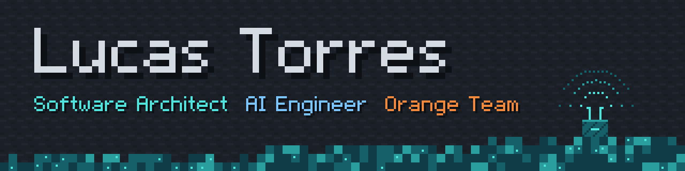

**Software Architect in training, AI Engineer, Orange Team.** I design systems, build them with AI agents, and keep security inside the design. From Paraguay.

Open to internships, junior roles and collaborations in software design, cybersecurity and AI engineering.

[Portfolio](https://turmedev.github.io/TurmeDev/)

---

## About

Computer Engineering student at **FP-UNA** (Facultad Politécnica, Universidad Nacional de Asunción). Started with hardware at five and moved into software in 2020. Today I'm studying distributed systems and computer networks, and putting them to work in agent tooling, architecture docs and a small LLM gateway.

## Three disciplines

- **Software Architect:** architecture decision records, C4 / ER / sequence / state / Event Storming models in Mermaid, IEEE 830 and 29148 requirements specs, distributed-systems foundations (invocation semantics, idempotency, sagas, logical clocks).
- **AI Engineer:** Claude Code as an agent runtime (skills, hooks, subagents, MCP), multi-agent pipelines, an always-on personal assistant over Telegram with Notion as memory.
- **Orange Team**, the bridge between how systems get attacked and the people who build them: Computer Networks I and II, agent security in practice (least privilege, permission hooks that fail closed, isolated users, Tailscale).

## Certificates and events

- Cisco Networking Academy: Introduction to Cybersecurity (May 2026)
- Cisco Networking Academy: Introduction to IoT (May 2026)
- AI Tinkerers Hackathon: Agents, Everywhere, Asunción chapter (September 2026)

## Stack

- **In use:** Python, Java, C / C++, Bash, FastAPI, Postman, Docker, Linux, Git, GitHub Actions, MCP, Tailscale
- **Learning next:** PostgreSQL, Redis, OpenTelemetry, OAuth 2.0

## Repositories

Most of my work is private for now: `llm-gateway` and `project-bootstrap` are being cleaned up for release, each with its own README and demo.

## Find me

- LinkedIn: [TurmeDev](https://www.linkedin.com/in/turmedev/)
- YouTube: [@TurmeDev](https://www.youtube.com/@TurmeDev)
- Email: [turmedev@gmail.com](mailto:turmedev@gmail.com)
